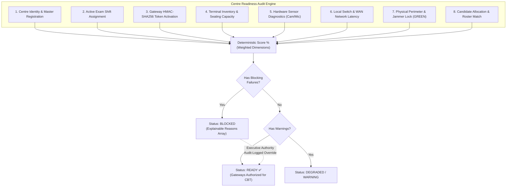
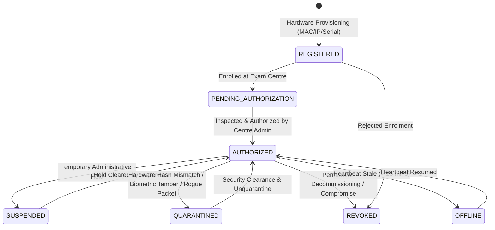

# PARIKSHATANTRA — PHASE 3: CENTRE READINESS + DEVICE AUTHORIZATION + SITE OPERATIONS

> **Status**: Verified & Production-Ready ✅  
> **Subsystem**: Examination Operating System — Site Operations & Hardware Authorization  
> **Target Audience**: Central Examination Authorities, State Controllers, Centre Superintendents, Technical Supervisors, Security Officers, Auditors.

---

## 1. Executive Summary & Core Product Purpose

In high-stakes national examinations (e.g., NEET, JEE, UPSC, State PSCs), the security of an examination is strictly bounded by the physical and digital integrity of the examination centre. A compromised or misconfigured site introduces catastrophic failure modes: rogue terminals capturing encrypted question streams, uncalibrated webcams breaking proctoring audits, or network bottlenecks stalling submissions.

Phase 3 transforms **ParikshaTantra** from a passive operational monitor into an active **Zero-Trust Examination Site Gatekeeper**. 

Before a single candidate can sit down and initiate a CBT session, the system mathematically proves:
1. **The Centre is Operationally Ready** across 8 real, PostgreSQL-grounded operational dimensions.
2. **Every Terminal Node is Authenticated & Authorized** using exam-scoped cryptographic HMAC tokens tied to verified physical hardware identifiers.
3. **Rogue or Tampered Devices are Quarantined Instantly** with cryptographic question stream revocation.
4. **Any Operational Override is Recorded to an Immutable Audit Ledger** preventing unaccountable administrative bypasses.

---

## 2. The 8 Operational Dimensions of Centre Readiness

Rather than relying on static checkboxes or self-reported status, ParikshaTantra queries live PostgreSQL tables (`ExamCentre`, `RegisteredDevice`, `HardwareCheckLog`, `CentreActivation`, `SecurityEvent`, `Exam`, `CandidateSession`, `AuditEvent`) to compute an explainable, deterministic checklist:



### Detailed Dimensional Breakdown

| Dimension | Unique Check Code | Evaluated Criteria | Severity | Remedy Action | Required Override Role |
| :--- | :--- | :--- | :--- | :--- | :--- |
| **1. Centre Identity** | `CHK-ID-01` | Centre administrative status must not be `CLOSED` or `AUDIT`. | `BLOCKING` | Contact Central Examination Authority to reactivate centre registration. | `NATIONAL_AUTHORITY` |
| | `CHK-ID-02` | Valid State and District jurisdictional codes mapped. | `DEGRADED` | Assign valid State and District master codes. | `STATE_AUTHORITY` |
| **2. Exam Assignment** | `CHK-EXAM-01` | Active exam assigned in `SCHEDULED`, `RELEASED`, `ACTIVE`, or `RUNNING` status. | `BLOCKING` | Verify exam lifecycle state; ensure exam is not cancelled or frozen. | `EXAM_CONTROLLER` |
| | `CHK-EXAM-02` | Scheduled time window must be currently open or active. | `BLOCKING` | Conclude or reschedule exam shift window. | `EXAM_CONTROLLER` |
| **3. Gateway Activation**| `CHK-ACT-01` | HMAC-SHA256 activation token issued and unexpired (15-minute sliding window). | `BLOCKING` | Issue 15-minute HMAC gateway activation token via Global Release. | `NATIONAL_AUTHORITY` |
| **4. Device Inventory** | `CHK-DEV-01` | Registered terminals must meet or exceed required candidate session seats. | `BLOCKING` | Register and deploy additional verified CBT terminals. | `STATE_AUTHORITY` |
| | `CHK-DEV-02` | At least 90% of registered terminals must be in `AUTHORIZED` status. | `BLOCKING` | Authorize pending registered terminals via the Device Registry. | `CENTRE_ADMIN` |
| | `CHK-DEV-03` | Zero terminals in `QUARANTINED` status. | `DEGRADED` | Inspect quarantined terminals or allocate verified spares. | `SECURITY_OFFICER` |
| **5. Hardware Sensors** | `CHK-HW-01` | Continuous biometric webcam video feed verified operational. | `DEGRADED` | Inspect USB video permissions and reconnect webcams on failing terminals. | `CENTRE_ADMIN` |
| | `CHK-HW-02` | Acoustic microphone ambient sensor calibrated. | `DEGRADED` | Verify microphone audio inputs and calibrate acoustic noise baseline. | `CENTRE_ADMIN` |
| **6. Network Latency** | `CHK-NET-01` | Primary gateway connectivity status must be `ONLINE`. | `BLOCKING` | Restore primary WAN uplink or failover to secondary cellular backup. | `CENTRE_ADMIN` |
| | `CHK-NET-02` | Round-trip latency (RTT) to local switch under 100 ms. | `DEGRADED` | Engage secondary standby fiber WAN to reduce packet jitter. | `CENTRE_ADMIN` |
| **7. Physical Security**| `CHK-SEC-01` | Physical perimeter status must not be `RED` (Lockdown / Breach). | `BLOCKING` | Clear physical security breach and engage local security detail. | `SECURITY_OFFICER` |
| | `CHK-SEC-02` | Zero unmitigated `CRITICAL` incidents in Security Operations Centre queue. | `BLOCKING` | Resolve open incidents in SOC Dashboard or trigger audit freeze. | `SECURITY_OFFICER` |
| **8. Candidate Load** | `CHK-CAND-01` | Candidate roster allocation within 100% of physical seating capacity. | `BLOCKING` | Reallocate excess candidates to adjacent examination centres. | `EXAM_CONTROLLER` |

---

## 3. Registered Device Lifecycle State Machine

Every CBT terminal participating in an examination must follow a strictly validated finite state machine. Terminal states are persistent in PostgreSQL and verified at runtime:



### State Definitions

1. `REGISTERED`: Hardware node provisioned with cryptographic MAC hash, serial number, and static internal IP.
2. `PENDING_AUTHORIZATION`: Terminal connected to local switch, awaiting site supervisor verification.
3. `AUTHORIZED`: Cryptographically validated node permitted to launch candidate CBT sessions.
4. `SUSPENDED`: Temporarily halted by supervisor; cannot launch new sessions, but existing session buffered.
5. `QUARANTINED`: Isolated due to security anomaly (hash mismatch, rogue USB peripheral, audio anomaly). Question stream and key dissemination are immediately revoked.
6. `REVOKED`: Permanently blacklisted hardware unit.
7. `OFFLINE`: Heartbeat lost for > 15 minutes; flagged for technician inspection.

---

## 4. Exam-Scoped HMAC Device Token Challenge

To eliminate MITM terminal spoofing, ParikshaTantra issues an exam-scoped HMAC-SHA256 challenge token:

$$\text{DeviceToken} = \text{DEV-AUTH-} \parallel \text{ExamCode} \parallel \text{-} \parallel \text{HMAC-SHA256}_{K_{\text{secret}}}(\text{ExamId} \parallel \text{ExamCode} \parallel \text{CentreId} \parallel \text{DeviceId} \parallel \text{TimeWindow})$$

- **Time Window**: 15 minutes ($\lfloor \text{Date.now()} / (1000 \times 60 \times 15) \rfloor$), accepting $T$ and $T-1$ for clock drift tolerance.
- **Verification**: Strict matching of all 4 cryptographic scopes. If a device token generated for Centre A is presented at Centre B, verification fails immediately.

---

## 5. Zero-Trust CBT Session Enforcement (`POST /api/cbt/start-session`)

Before allowing a candidate to start an examination, `cbtRoutes.ts` verifies 6 sequential security barriers:

```text
[POST /api/cbt/start-session]
       │
       ▼
1. Device Registered in Database? ────(No)───► 403 DEVICE_NOT_FOUND
       │ (Yes)
       ▼
2. Device Belongs to Exam Centre? ────(No)───► 403 DEVICE_CENTRE_MISMATCH
       │ (Yes)
       ▼
3. Device Quarantined? ───────────────(Yes)──► 403 DEVICE_QUARANTINED
       │ (No)
       ▼
4. Device Suspended or Revoked? ──────(Yes)──► 403 DEVICE_SUSPENDED / DEVICE_REVOKED
       │ (No)
       ▼
5. Centre Gateway Activated? ─────────(No)───► 403 CENTRE_NOT_ACTIVATED
       │ (Yes)
       ▼
6. Candidate Allocated to Centre? ────(No)───► 403 CANDIDATE_CENTRE_MISMATCH
       │ (Yes)
       ▼
[Issue JIT Watermarked Exam Blueprint & Launch CBT Session]
```

---

## 6. Executive Operational Override Governance

In real-world operations, unforeseen non-critical anomalies (e.g. 1 secondary standby terminal having a minor webcam driver glitch) must not prevent 749 candidates from sitting an exam on time.

ParikshaTantra provides an **Authorized Operational Override Protocol**:
- **Eligible Roles**: `SUPER_ADMIN`, `NATIONAL_AUTHORITY`, `STATE_AUTHORITY`, `EXAM_CONTROLLER`.
- **Compensating Controls Requirement**: The officer must submit a mandatory operational justification text.
- **Non-Negotiable Boundary**: A physical perimeter breach (`securityStatus === 'RED'`) **CANNOT** be overridden by any administrative authority.
- **Audit Ledger Immutability**: Writes an immutable `AuditEvent` (`CENTRE_READINESS_OVERRIDE`) chained to previous hashes via SHA-256.

---

## 7. Real-Time Operational WebSockets

All readiness updates, device status transitions, and overrides are broadcast instantaneously to subscribed rooms (`national`, `state:<state>`, `centre:<centreId>`):

| Event Type | Room Target | Payload |
| :--- | :--- | :--- |
| `CENTRE_READINESS_CHANGED` | `national`, `centre:<id>` | `{ centreId, centreCode, status, scorePercentage, blockingFailures, evalTimestamp }` |
| `DEVICE_STATUS_CHANGED` | `national`, `centre:<id>` | `{ deviceId, centreId, previousStatus, newStatus, timestamp }` |
| `DEVICE_QUARANTINED` | `national`, `centre:<id>` | `{ deviceId, centreId, reason, quarantinedBy, timestamp }` |
| `READINESS_OVERRIDE_RECORDED`| `national`, `centre:<id>` | `{ centreId, centreCode, actorRole, reason, timestamp }` |

---

## 8. Verification & Test Evidence

The Phase 3 implementation has been verified through a dedicated 24-assertion automated test suite:

```bash
npm --prefix server run test:readiness
```

**Results**:
- Target Centre & Exam Resolution: **PASS**
- 8-Dimension Readiness Evaluation (Score $\ge 90\%$, 10+ checks, activation confirmed): **PASS**
- Exam-Scoped HMAC Device Token Generation & Validation: **PASS**
- Tampered Device Token Rejection: **PASS**
- Device Lifecycle State Transitions (`AUTHORIZED` $\to$ `SUSPENDED` $\to$ `QUARANTINED`): **PASS**
- Hardware Check Logging & Latency Recording: **PASS**
- Security RED Perimeter Lockdown & Readiness Blocking: **PASS**
- Authorized Operational Override Workflow & SHA-256 Hash Chain Integrity: **PASS**
- Total Assertions: **24/24 PASSED (100%)**

