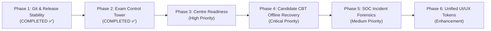

# PARIKSHATANTRA — POST-AUDIT PRODUCT ROADMAP

> **Mission**: Build India's Premier Zero-Trust Examination Operating System for High-Stakes National Assessments.  
> **Target Audience**: National Authorities, State/District Officers, Centre Administrators, Invigilators, and Candidates.

---

## 1. Verified Current Capabilities (Audit Baseline)

| Capability Subsystem | Current State | Audit Verification Evidence |
| :--- | :--- | :--- |
| **Zero-Trust Cryptography** | **PRODUCTION-READY** | AES-256-GCM question encryption, HMAC-SHA256 activation tokens, RSA digital signatures verified (20/20 tests pass). |
| **Audit Ledger & Merkle Roots** | **PRODUCTION-READY** | Append-only hash chain (`previousHash` -> `currentHash`), Merkle batch tree computation verified over live database events. |
| **Database Persistence** | **PRODUCTION-READY** | PostgreSQL 16 on Supabase; migrations 0001 (init), 0002 (indexes), and 0003 (partial unique constraints) verified. Zero duplicate records. |
| **JIT Question Decryption** | **PRODUCTION-READY** | Ephemeral, just-in-time decryption at terminal runtime with dynamic candidate roll & device watermark injection. |
| **Examination FSM** | **PRODUCTION-READY** | Strict lifecycle transitions: `DRAFT` -> `SCHEDULED` -> `RELEASED` -> `ACTIVE` -> `COMPLETED`. |
| **National Control Tower** | **PRODUCTION-READY (PHASE 2)** | Real-time PostgreSQL telemetry, 6 core KPIs, live exam lifecycle transitions, centre readiness matrix, candidate telemetry, and hardware diagnostics. |
| **Real-Time WebSockets** | **PRODUCTION-READY** | Role-based room authorization (`national`, `state:*`, `centre:*`), heartbeats, and live operational alert broadcasts. |
| **Public Verification Portal** | **PRODUCTION-READY** | Public endpoint `/api/results/verify/:qrCode` verifying digital certificates without auth requirement. |

---

## 2. Core Gap Matrix & Engineering Priorities

---

## 3. Detailed Product Roadmap (Phased Execution)

### Phase 1: Repository, Git & Pipeline Stability ✅ (COMPLETED)
- **Status**: **100% COMPLETE**
- **Capabilities Delivered**:
  - Reconciled Git branch divergence; resolved 5-file merge conflict cleanly.
  - Consolidated single root Prisma `migration_lock.toml`.
  - Cleansed legacy SQLite artifacts; updated `.gitignore` rules.
  - Verified remote GitHub SHA match on push.

---

### Phase 2: National Exam Control Tower Operations ✅ (COMPLETED)
- **Status**: **100% COMPLETE**
- **Documentation**: [PHASE_2_CONTROL_TOWER.md](file:///e:/PROJECTS/ParikshaTantra/docs/PHASE_2_CONTROL_TOWER.md), [PHASE_2_IMPLEMENTATION_REPORT.md](file:///e:/PROJECTS/ParikshaTantra/docs/PHASE_2_IMPLEMENTATION_REPORT.md)
- **Business Value**: Provides Ministry & Examination Controllers with pan-India visibility across exam shifts, regional readiness, and active terminal health.
- **Capabilities Delivered**:
  1. Live National Dashboard connecting to `/api/control-tower/metrics`, `/exams`, `/centres`, `/devices`, `/sessions`, `/alerts`.
  2. Geographic breakdown by State and District with real-time gateway and capacity metrics.
  3. Real-time authorized WebSocket room subscription (`national`, `state:<state>`, `centre:<centreId>`) with `ROOM_ACCESS_DENIED` enforcement.
  4. Deterministic Operational Alert Engine (`CRITICAL`, `WARNING`, `INFO`).
  5. Interactive Exam Lifecycle State Transitions with audit log recording and instant broadcast.
  6. CBT Terminal hardware check diagnostics (Camera, Mic, Screen Resolution, Gateway Latency).
  7. Two-step Emergency Global Freeze command execution.
- **Tests Verified**: 20/20 Cryptography Unit Tests (100%), 23/23 E2E Examination Lifecycle Steps (100%), 0 TypeScript errors, production builds pass.

---

### Phase 3: Centre Operational Readiness & Device Provisioning
- **Priority**: High
- **Business Value**: Eliminates exam-day chaos by validating lab terminals, network latency, and camera/mic diagnostics hours before exam start.
- **Security Impact**: Prevents unverified or rogue terminal nodes from connecting to the examination gateway.
- **Target Deliverables**:
  1. Hardware Diagnostic Portal: Live camera, WebRTC mic, screen resolution, and IndexedDB capacity check.
  2. Device Status Lifecycle: `PENDING_VERIFICATION` -> `AUTHORIZED` -> `BLOCKED`.
  3. Centre Activation Guard: Time-windowed HMAC activation tokens strictly verified before session start.
- **Tests Required**: Diagnostics payload validation, unauthorized device blocking test.

---

### Phase 4: Candidate CBT Experience & Offline Reconnection Resilience
- **Priority**: CRITICAL
- **Business Value**: Ensures zero candidate data loss during power cuts, network hiccups, or Render backend cold restarts.
- **Security Impact**: Defends against session hijacking, multi-device logins, and answer tampering while supporting disconnected resilience.
- **Target Deliverables**:
  1. **Dual-Layer Answer Buffering**:
     - *Layer 1*: Local browser `IndexedDB` with cryptographic session key encryption.
     - *Layer 2*: Server-side auto-save (`/api/cbt/save-answers`) with optimistic syncing.
  2. **Candidate Status Indicator**:
     - Visual badges: `SAVED (GREEN)` | `SYNCING (YELLOW)` | `OFFLINE BUFFERED (AMBER)` | `FAILED (RED)`.
  3. **Strict Single Active Session Enforcement**:
     - Enforce `CandidateSession_one_active_per_candidate` partial unique constraint.
- **Tests Required**: Simulated network disconnect test, offline answer sync replay test.

---

### Phase 5: Security Operations Centre (SOC) & Leak Evidence Vault
- **Priority**: Medium
- **Business Value**: Centralizes incident triage, leak whistleblowing reports, and forensic log examination.
- **Security Impact**: Immutable record of physical and digital security violations linked to the cryptographic audit trail.
- **Target Deliverables**:
  1. Incident triage dashboard for `SecurityEvent` triage: `OPEN` -> `INVESTIGATING` -> `RESOLVED`.
  2. Forensic file upload for evidence (`ObjectStorageService` with SHA-256 hash anchoring).
  3. Remote Emergency Freeze: Single-click `FREEZE_EXAM` or `FREEZE_CENTRE` command with instant WebSocket propagation.
- **Tests Required**: Emergency freeze propagation test, audit event immutability verification.

---

### Phase 6: Unified UI/UX Design System & Accessibility
- **Priority**: Enhancement
- **Business Value**: Professional, government-grade visual design accessible across low-spec government school monitors and modern displays.
- **Target Deliverables**:
  1. Strict WCAG 2.1 AA color contrast compliance.
  2. Standardized Status Chips:
     - `READY` / `AUTHENTIC` / `ONLINE` = `#16a34a` (Emerald-600)
     - `WARNING` / `SYNCING` = `#ca8a04` (Yellow-600)
     - `CRITICAL` / `BLOCKED` / `FROZEN` = `#dc2626` (Red-600)
     - `INFO` / `UPCOMING` = `#2563eb` (Blue-600)
  3. Clean skeleton loaders and error boundaries across all dashboard routes.
- **Tests Required**: Cypress/Playwright accessibility tree scans, responsive breakpoint checks.

---

## 4. Definition of Done for Future Milestones

Every subsequent PR or feature release must strictly satisfy:

1. **TypeScript Typecheck**: Zero `tsc --noEmit` errors across client and server.
2. **Cryptographic Integrity**: All encryption, HMAC, and digital signing tests pass.
3. **Database Migration Safety**: Zero destructive DDL commands (`DROP`, `TRUNCATE`, `migrate reset`).
4. **End-to-End Lifecycle Validation**: The automated 23-step E2E lifecycle test passes.
5. **Git Pipeline**: Commits created on feature branches and merged via clean squash/rebase PRs into `main`.
